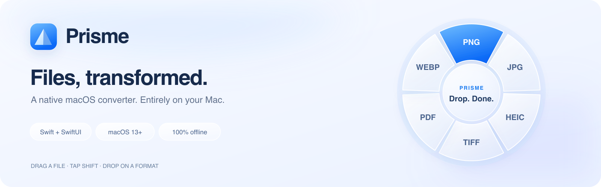
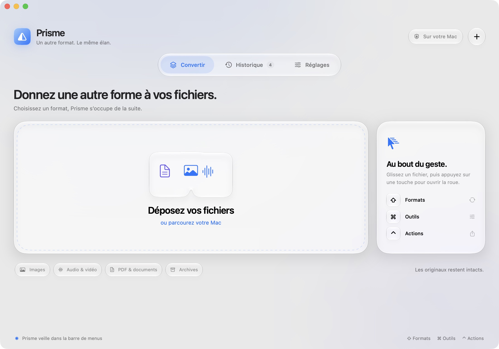
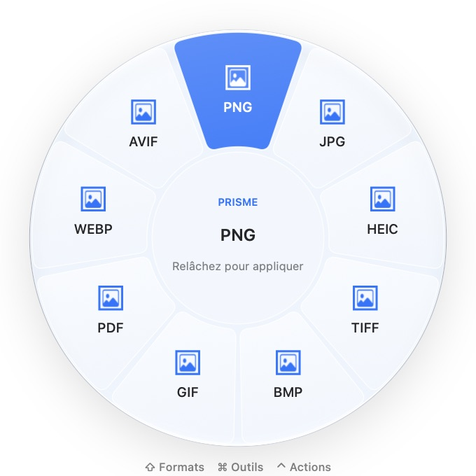

# Prisme



A local file workshop for macOS, written in Swift, SwiftUI and AppKit. Drag a
file in Finder, tap **Shift**, and drop it on a segment of the circular wheel.
Release the key while continuing to drag: the wheel stays open until the drop
or cancellation. **Command** selects tools and **Control** selects file actions.
The three keys and wheel appearance are configurable.

Prisme has its own visual identity and implementation. The interface is in
French. There is no account, subscription, conversion allowance, telemetry, or
upload service.

## A closer look



<table>
<tr>
<td width="40%"></td>
<td>
<strong>A format at the end of a gesture.</strong><br><br>
Drag a file, tap <strong>Shift</strong>, and release it over a format.
The glass wheel appears beside your pointer; the selected segment turns blue.
<br><br>
<strong>Command</strong> opens tools. <strong>Control</strong> opens file actions.
The keys and wheel appearance can be changed in Settings.
</td>
</tr>
</table>

Actual screenshots of version 0.2.0 on the development Mac. The banner is an
original illustration; its editable source is [included](docs/images/banner.svg).

## Run

Runs on **macOS 13 or later**. Building requires **Xcode 26 or newer**, including
its SDK and command-line tools:

```sh
./scripts/build-app.sh
open dist/Prisme.app
```

For everyday use, drag `dist/Prisme.app` into the macOS Applications folder.
Then press Command–Space, type **Prisme**, and press Return. The menu bar icon
keeps the conversion wheel available after closing the main window. Prisme runs
as a menu bar app without a Dock icon, including while its window is visible.
Closing the window leaves the app and drag wheel running. Use **Open Prisme**
in the menu bar to reopen it, or **Quit Prisme** to stop the app explicitly.

To build a universal Apple silicon + Intel application:

```sh
./scripts/build-app.sh --universal
```

The script creates `dist/Prisme.app` and `dist/Prisme-macOS.zip`, with an original
icon and an ad hoc local signature. Distribution outside your own Mac requires
your own Developer ID signing and Apple notarization. Source compatibility is
targeted at macOS 13; runtime testing performed on the development Mac does not
establish testing on every older macOS version or Intel hardware.

Optional, independently installed engines add media and document formats:

```sh
brew install ffmpeg pandoc webp libavif
```

Prisme searches `/opt/homebrew/bin`, `/usr/local/bin`, and system tool paths.
It does not copy conversion helpers from the reference application. Engines
are external dependencies, not bundled into the app. Audio/video need FFmpeg;
WebP encoding needs `cwebp`; AVIF uses `avifenc` or an available system encoder;
extended document conversions need Pandoc. Missing-engine operations are hidden.

## Use

1. Keep Prisme running; the menu bar icon remains available after closing its window.
2. Start dragging a file from Finder and tap Shift. Move over the desired wheel
   segment and release the mouse. The wheel remains in place as you move.
3. Tap Command during the drag for file tools, or Control for file actions.
4. Alternatively, drop files into the main window, select an operation, and
   run it. **Open wheel** offers the same circular interface for a selection.

The original files are preserved by conversion operations. Completed outputs get
unique names beside the source or in a chosen output folder. Temporary output is
removed when its operation fails or is cancelled. For multi-file or multi-page
operations, earlier completed outputs may remain if a later item fails.

The global wheel reads the system drag pasteboard only while a mouse drag and
configured modifier are detected; it does not install a keyboard event tap.
Other utilities using the same drag gesture can show their own overlays too;
close them while testing Prisme's gesture.

## Implemented scope

Version 0.2 introduces a blue glass interface, floating navigation, a translucent
workspace, and a matching app icon. It follows the system's light/dark appearance.
On macOS 26 and later, including macOS 27, controls use Apple's
[SwiftUI Liquid Glass](https://developer.apple.com/documentation/swiftui/glasseffectcontainer)
and the wheel uses [NSGlassEffectView](https://developer.apple.com/documentation/appkit/nsglasseffectview).
Older macOS versions use vibrancy/material fallbacks. Reduce Transparency and
Reduce Motion accessibility preferences are respected. CI uses macOS 26 so it
compiles against a Liquid Glass-capable SDK while keeping the macOS 13 target.

| Family | Operations |
| --- | --- |
| Images | PNG, JPEG, HEIC, TIFF, BMP, GIF, PDF, WebP, AVIF; resize, rotate, JPEG compression |
| PDF | Merge PDFs/images, split pages, rotate, rasterize to PNG/JPEG, extract existing text, raster compression |
| Audio | MP3, M4A, WAV, FLAC, AIFF, OGG/Opus; trim |
| Video | MP4, MOV, WebM, GIF; trim, compress, extract audio |
| Documents | TXT, RTF, HTML, DOCX, Markdown; text-based PDF; Pandoc-readable EPUB and other text inputs |
| Tables | CSV, TSV, JSON; quoted fields, embedded newlines and UTF-8/UTF-16 text |
| Subtitles | SRT, VTT, plain text; preserve cue timing in timed formats |
| Archives | Create ZIP/TAR/GZIP; extract supported libarchive formats into a new folder |
| File actions | Reveal in Finder, copy files, copy paths, AirDrop, open parent directory in Terminal |

Images are converted as still images (first frame). JPEG flattens transparency
onto white. PDF compression rasterizes pages and removes selectable text; it
does not guarantee a smaller file. PDF text extraction performs no OCR.
Documents exported as PDF are paginated text, not a layout-preserving Office
renderer. OGG uses Opus with the installed FFmpeg build. Input support is subject
to the decoders on the machine. ProRes, HDR/color fidelity, password-protected
PDFs, Pages/Keynote editing, full XLSX/ODS processing, and full parity with the
reference are outside this version's verified scope.

The local history retains paths and output records for the latest 100 successful
operations in this app's macOS preferences. Clearing history does not delete files.
No source files, test photos, or reference application resources belong in Git.

## Development and verification

Open `Package.swift` in Xcode, or use:

```sh
swift build
swift test --disable-sandbox
```

`PrismeCore` owns conversion, subprocess cancellation, unique output commits,
safe archive extraction, and wheel selection geometry. `Prisme` owns SwiftUI
screens, menu bar lifecycle, AppKit drag tracking, and the radial drop target.
Tests generate their own fixtures. Optional-engine tests skip only when the
engine is missing. CI builds and tests on macOS and uploads the built app.

## Reference investigation

REA 6.7.0 was installed and used to inspect the locally installed Tangerine
bundle. Static dependency and artifact observations, their Evidence IDs, and
the distinction between observations and unverified behavior are recorded in
[the analysis report](docs/REFERENCE_ANALYSIS.md).

```sh
./scripts/analyze-reference.sh /Applications/Tangerine.app
```

Raw investigation results remain in ignored `.analysis/`. No license checks,
trial counters, original binaries, artwork, or proprietary resources are modified
or included. REA is available from its [official repository](https://github.com/morluto/rea).

## Acknowledgments

- [Tangerine](https://tangerineformac.com/) and its creators inspired the
  drag + modifier key workflow and circular conversion interface. Prisme is an
  independent implementation with its own code, branding and artwork, and is
  not affiliated with or endorsed by Tangerine.
- [REA](https://github.com/morluto/rea), by morluto and its contributors, was
  used for local static inspection during development. REA is
  [MIT-licensed](https://github.com/morluto/rea/blob/main/LICENSE) and is not
  bundled with Prisme.
- [FFmpeg](https://ffmpeg.org/), [Pandoc](https://pandoc.org/),
  [libwebp](https://developers.google.com/speed/webp) and
  [libavif](https://github.com/AOMediaCodec/libavif) provide optional conversion
  engines through separately installed command-line tools. They retain their
  own licenses and are not included in Prisme's application bundle.

The README banner, app icon and screenshots were created for Prisme. No
Tangerine code, icons, screenshots or packaged conversion helpers are included.
